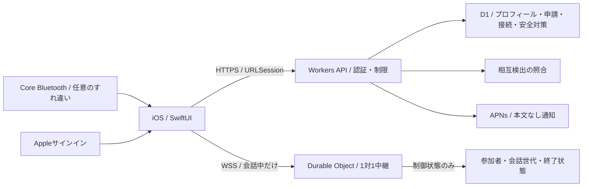

# AirTalk 1.4 オンライン機能・設計提案

作成: 2026-11-06（JST）、更新: 2026-11-07。段階Bの設計原案。**2026-11-07、ユーザーの続行指示でローカル実装へ進行。サーバーコードは作成済み・クラウド未デプロイ。**

実装との差分、実行手順、残項目は [ONLINE_1.4_RUNBOOK.md](ONLINE_1.4_RUNBOOK.md) を参照。特にD1→SQLite Durable Objectへの集約、保持・更新・復元の制約を更新している。
ユーザー指示によりBLE実機テストを後回しにして設計・画面試作を先行する。実機未検証を解消したことにはしない。

## 1. 利用者体験と初版の範囲

既存のオフライン機能を残し、「すれ違い → 相手を選んで申請 → 相互承認 → オンライン1対1 → 双方が希望した場合だけ接続関係を残す」を追加する。
オンライン機能は別途同意・Appleサインインが必要。ローカルプロフィールを勝手にアップロードしない。
基本の発見・申請・会話・通報・ブロック・削除は無料。既存Plusは維持し、新商品は作らない。

ユーザーは未成年対応を希望する一方、難しければ18歳以上でもよいと回答。初期のオンライン限定検証は18歳以上とし、未成年対応は年齢層の分離・保護・通報運営を追加設計してから判断する。未成年対応が不可能と判断したわけではない。自己申告は年齢確認済みや本人確認済みの証明ではない。恋愛専用・異性検索・距離順表示は作らない。
初版の公開範囲は招待された検証協力者50人まで。一般公開は年齢方針・通報運営・BLE実測・プライバシー表示を確定してから。
写真・動画・音声・公開検索・公開ルーム・ブラウザ参加・ランダム自動接続・アドレス帳取得・常時位置取得は含めない。

### 画面

1. 既存レーダーに任意の「すれ違い」導線を追加（実サービス接続後）。既存チャットを開くための登録は不要。
2. 初回説明で共有情報・会話消去・年齢方針・規約を確認してAppleでサインイン。BLE検出は独立したスイッチで同意。
3. すれ違い一覧は過去24時間以内。相手のニックネーム・定型の興味・ひとこと・SF Symbolsアイコンのみ。
4. 「話してみたい」を送り、リクエストタブで承認・見送り。承認前に自由文は送れない。既読・拒否理由は返さない。
5. 承認後に会話を開始。相手がまだ開いていなければ待機。プッシュは内容を含めず、許可した人だけへ通知。
6. 会話中に「また話したい」。双方の意思が会話終了前に一致した場合だけ、つながりを保持。片方の希望を相手に自動通知しない。
7. つながった相手でも次回は会話開始リクエストに双方同意する。一方的に新規会話を送りつけない。
8. ブロック・通報・接続解除・アカウント削除をオンライン設定と相手メニューに置く。

画面試作は `-demo YES -demoScene online` / `onlinePeople` / `onlineInbox` / `onlineChat` / `onlineConnections`（Debugのみ）。
相手承諾・返信は明示的な「再現（デモ）」操作でしか発生しない。実在相手・本物の通信に見せかけない。

## 2. サーバー候補と費用

確認日: 2026-11-06。料金はUSD・税／為替／別途ドメイン費用を含めない。費用上限の保証ではない。

| 案 | 利点 | 負担 | 判断 |
|---|---|---|---|
| Cloudflare Workers + D1 + Durable Objects | WebSocket中継と短いAPIを小さく始められる。無料枠あり | Apple認証、アクセス制御、通報管理を実装する必要 | 推奨候補 |
| Supabase Auth + Postgres + Realtime | 認証・DB・管理機能が揃い、運営開発を減らせる | 保持・Realtime権限設計が必要。Proは月$25〜 | 認証保守負担が大きければ再評価 |
| 自前VPS + WebSocket + DB | 実行・保存方式を制御しやすい | パッチ、バックアップ、障害対応、可用性を自分で運営 | 個人開発の初版では見送る |

### 推奨構成の試算

- ユーザーは無料検証開始・有料化の別途確認を選択。最初はWorkers Freeで限定検証。有料プランには自動移行しない。上限到達はオンラインのみ停止し、オフライン機能は残す。
- Workers Paidの最低料金は月$5。検証後の予算目安は$5〜10/月だが、契約前に別途確認する。
- Durable Objects Freeは100,000 requests/day、13,000 GB-s/day。WebSocket Hibernationで待機中の実行時間課金を減らす。
- 仮に50人、1人20 API操作/日、100会話/日×100メッセージとする。API約1,000/日、メッセージ10,000/日。認証照会・制御RPC・リトライ・ハートビートを含む実測が必要で、この数字を請求保証にしない。
- 画像を扱わず、大量の一覧ポーリングを避ける。サインイン失敗・申請・識別子照会・WSフレームに利用者別上限を設定する。
- 有料時の予算通知やCPU上限は請求の完全なハードキャップではない。日次の新規接続上限と運営用オンライン停止スイッチを別に実装する。

出典: [Workers pricing](https://developers.cloudflare.com/workers/platform/pricing/)、[Durable Objects pricing](https://developers.cloudflare.com/durable-objects/platform/pricing/)、[WebSocket Hibernation](https://developers.cloudflare.com/durable-objects/best-practices/websockets/)、[Supabase pricing](https://supabase.com/pricing)。

## 3. 構成とデータの流れ

iOSの外部SDKは追加せず、AuthenticationServices、URLSession、Keychain等を使う。オンラインコードは既存MultipeerManagerから分離する。
バックエンドはTypeScript。ローカル開発ツールとしてWrangler等を使う場合も、iOSランタイムの依存とは分ける。

- HTTPS APIが認証・同意・利用停止・入力制限を検証し、プロフィールと接続の権限を管理する。
- D1は会話以外の状態を保存。本文を入れるテーブルは作らない。
- 会話ごとのDurable Objectが2人だけのWebSocketを中継。本文をDB、DO storage、WebSocket attachment、Queue、ログへ書かない。
- 休止／再起動に備え、メッセージとは別の制御情報（参加者ID、世代、終了状態）だけ保存する。
- 旧世代のWS・入室チケット・再送を拒否。終了した会話を復元しない。新会話は新しいID／世代を発行する。
- オフライン用MCPeerIDとオンライン用accountIDは別物。表示名をアカウント識別や権限判定に使わない。

### 認証

Appleサインインの一回限りnonceと認可コードをサーバーで検証し、iss/aud/exp/署名を確認する。名前・メールをログイン識別子に使わない。
メール・実名スコープは要求しない。Appleから返る余分な属性も保持しない。
アプリ独自の短命access token（15分）、ローテーションするrefresh token（最大30日）を発行。端末はKeychain、この端末のみの属性で保存。
refresh tokenはサーバーでハッシュ保存。Apple失効用資格情報は暗号化保管し、アカウント削除時にAppleのトークンも失効させる。
ログアウト・停止・削除は既存WSにも適用し、接続時だけ認証して放置しない。

[Apple: user verification](https://developer.apple.com/documentation/signinwithapple/verifying-a-user)、[account deletion](https://developer.apple.com/documentation/technotes/tn3194-handling-account-deletions-and-revoking-tokens-for-sign-in-with-apple)。

### 暗号化の提案

初期限定検証はHTTPS/WSSによる通信路暗号化。サーバーは中継中の本文を読めるため、**E2EEとは表示しない**。
サーバーが内容を永続保存しないことと、サーバーから内容を読めないことは別。
E2EEは鍵検証・再接続・通報・複数端末を含む追加設計が必要。独自の暗号プロトコルを急造しない。
一般公開前に、この通信路暗号化方式でよいかユーザー承認を得る。E2EE必須なら工程・工数を再見積もりする。

## 4. BLEからプロフィールを解決する際の境界

段階Aの17 byte試作パケットを本番の識別・認証に使わない。単に取得したUUIDをAPIへ送ればプロフィールが返る方式は採用しない。

本番候補（BLE実機の相互交換を測定してから実装）:

1. オンライン同意・認証済み端末へ、サーバーが短命のランダム検出tokenを事前発行。DBではハッシュとアカウントの対応を保持する。
2. BLEで両端末がtokenとランダムchallengeを交換。サーバー登録済みの端末署名鍵で双方のtoken・challenge・プロトコル版を含むreceiptを署名する。秘密鍵はKeychain、署名はCryptoKitの標準機能。
3. 復帰時にHTTPSでreceiptをまとめて提出。双方の有効な署名、tokenの有効範囲、一回限りnonce、同意状態、ブロック状態が一致した場合のみ一覧に出す。
4. 相手の公開プロフィールを取得できるのは、照合された当事者だけ。未照合のtokenから名前を返さない。
5. 電波がなくても検出receiptはローカル保持し、後で送れる。ただし事前発行tokenの期限内に限る。期限切れは新規オンライン照合を止め、通常オフラインチャットは維持。

署名は改変や単純なリプレイへの対策であり、電波の中継攻撃・共謀・GPS相当の近接証明を防げない。位置や距離を保証する表示はしない。
移動している2台が背景で相互交換を完了できるかは未検証。片側readしかできない場合、プロフィール解決を開放して妥協せず、本番仕様を見直す。
時刻だけで近接性を証明しない。サーバー時刻とtoken期限を優先し、端末時計がずれたreceiptは照合失敗として扱う。

## 5. 保存・消去・安全性（承認用初期値）

| データ | 保持案 | 削除／例外 |
|---|---|---|
| アカウント・公開プロフィール・同意版 | アカウントが有効な間 | 削除要求で即非公開・ログイン失効、稼働DBは24時間以内に削除 |
| BLE token対応・相互receipt・すれ違い関係 | 最大24時間 | APIでは期限を即判定、期限切れ物理行削除は毎時 |
| 申請 | 作成から24時間、かつすれ違いの期限内 | 見送り・取消・期限切れで再利用不可 |
| 会話本文・リアクション・入力中の下書き | 会話中のメモリだけ | 終了・背景移行・通信断・ブロック時に消去。キューや通知に本文を入れない |
| 接続関係 | 双方が会話中に希望した場合のみ | どちらかの解除・ブロック・退会で削除 |
| ブロック | ブロックを解除するまで | アカウント削除時に削除。再登録対策は別の期限付き安全記録 |
| 通報理由・対象・提出日時 | 90日を提案 | 通常本文は自動添付しない。証拠提供は別同意。必要性を定期見直し |
| 利用停止のための最小識別ハッシュ | 停止終了まで、最大180日を提案 | 完全な再登録防止を保証しない。ポリシーに開示 |
| 運用集計 | 日次件数・エラーコードのみ30日 | 人物ID・token・本文・IPをアプリログに含めない |
| プッシュtoken | 登録中のみ | 失効・ログアウト・退会で削除 |

D1 Time TravelはFree 7日／Paid 30日。稼働DBの削除とバックアップからの完全消去は同時ではない。
バックアップの復元時は削除台帳・期限を再適用し、削除アカウントを再公開しない。削除台帳は最大バックアップ期間を超える35日保持し、プロフィール本文は載せない。
上記24時間は利用可能期間と稼働データの保持案であり、バックアップから24時間以内に物理消去すると約束しない。

Workers invocation logはURL等を含み得るので無効化。認証情報やBLE tokenはURLクエリに置かず、body/headerで扱う。管理者アクセスは別認証で保護。
クラウド事業者自身のセキュリティログ等は別途確認が必要で、サービス全体を「ログなし」と表示しない。

[D1 limits / backup duration](https://developers.cloudflare.com/d1/platform/limits/)、[Workers Logs](https://developers.cloudflare.com/workers/observability/logs/workers-logs/)。

### 会話終了・通信断

- 初版はオフライン版同様、background移行で端末の本文・下書きを即消去。inactiveだけで終了させず、OSの権限ダイアログ等を区別。
- 明示終了はサーバーへendを送り、相手にも終了通知。ローカル消去は送信成功を待たない。
- 通信断を検知した端末は即消去。相手側はcloseまたは会話中だけの15秒heartbeat／45秒timeoutで終了する。検知までの遅延があり、全端末同時消去を保証しない。
- 同一会話を自動再開しない。双方承諾後の新しい会話として開始。未配達本文を後から再送するキューは作らない。
- 相互の「また話したい」が確定している場合だけ、本文を含まない接続関係を残す。
- 1アカウント同時会話1件。初版は1アカウントにつきアクティブ端末1台。新端末のログインで旧会話を終了。

### 通報・ブロック運用

- 申請前も含めて、相手のアカウントIDに対してブロック可能。名前変更で解除されない。
- ブロックが成功と表示される前に、稼働DBの拒否状態を保存し、該当会話DOへ失効通知して双方のWSを閉じる。
- DOは非同期処理後にも会話世代・終了状態を再検査する。ブロック完了後に古い送信処理が中継を再開しない。
- 通報は理由と対象を確認して送信。本文を証拠として任意送信する場合は別画面で内容を見せる。報告後はブロックして会話を終了する。
- プロフィールと投稿の不適切内容フィルタ、送信頻度制限、管理者の確認・停止画面が公開前に必要。
- 通報の対応者は開発者。初期目標は24時間以内の確認。対応できない場合に新規参加を止める仕組みを用意する。
- 年齢・通報データ・地域ごとの要件は一般公開前の確認事項。18歳自己申告だけで年齢確認を完了したとは扱わない。

## 6. APIの最小契約案

全APIは `/v1`、HTTPS、JSON。認証済みsubjectから自分を確定し、クライアント指定のsender/accountIDで権限を決めない。
日付はUTCのISO 8601。APIエラーは `{code, retryAfterSeconds?}`。個人情報や内部例外を返さない。
更新はIdempotency-Keyを受け、同一アカウント・同一操作の重複で申請・会話を増殖させない。

| 操作 | 契約 |
|---|---|
| `POST /auth/apple/challenge` | 一回限りnonce発行（5分） |
| `POST /auth/apple` | nonce・identityToken・authorizationCodeを検証し、独自セッションを返す |
| `POST /auth/refresh` / `POST /auth/logout` | refresh更新／全端末資格失効 |
| `GET/PATCH /me/profile` | name（48 UTF-8 bytes）、intro（120 bytes）、許可icon、最大3個の定型interestID |
| `PUT /me/consents` | 規約版・公開同意・BLE検出同意・年齢申告（個別） |
| `POST /encounter-tokens` | 同意済み端末だけに期限付きtokenを発行。大量発行制限 |
| `POST /encounter-receipts` | 相互receiptを最大20件まとめて照合。本文・位置・RSSI不可 |
| `GET /encounters` | 期限・ブロックを除外した相手カード。正確な時刻・場所は返さない |
| `POST /requests` | 有効なencounterIDまたは相互connectionIDから申請。任意accountIDへの申請不可 |
| `GET /requests` | 自分の受信／送信のみ |
| `POST /requests/{id}/accept` / `decline` | 受信者だけが操作。承認と同時に双方の状態を再確認 |
| `POST /conversations` | 承認済みrequestから新規会話。二重開始を排除 |
| `POST /conversations/{id}/ticket` | 参加者だけに30秒・一回限りWS入室ticketを発行 |
| `WSS /conversations/{id}` | ticketはAuthorizationヘッダー。チャット本文・react・end・heartbeatを中継 |
| `POST /conversations/{id}/reconnect-intent` | 自分の希望のみ記録。相手の希望を偽装不可 |
| `GET/DELETE /connections[/{id}]` | 相互成立の一覧／解除 |
| `POST /blocks` / `POST /reports` | 即遮断／理由を明示して提出。通常本文なし |
| `DELETE /me` | 即失効・非公開、Apple token取消・稼働データ削除ジョブ |

WSフレームは `{v:1, conversationID, epoch, messageID, type, payload}`。senderはサーバーが付ける。
本文最大1,000文字かつ4,000 UTF-8 bytes、フレーム8KB、端末履歴最大200件。無効JSON・未知type・重複ID・旧epochは拒否。
送信成功・配達確認を区別する。配達確認が届かないまま切断した本文は消去し、自動再送しない。

DBの主要エンティティ: accounts, consents, profiles, devices, auth_sessions, encounter_tokens, receipts, encounters, requests, connections, blocks, reports, deletion_jobs。
会話制御状態はDO側。pending/accepted/declined/expired、active/endedを明示し、状態遷移とブロックの競合を条件付き更新で扱う。
メッセージテーブルは作らない。索引は自分のID＋期限、pairID、token hashを基本とし、全ユーザー検索を公開しない。

## 7. 実装順と公開条件

1. 今回: 設計文書・ローカル画面試作・会話状態モデル。実機結果なしでも進められる範囲。
2. ユーザーの続行指示により設計承認待ちは解除。無料限定検証・18歳以上・通信路暗号化で実装。有料化と一般公開は引き続き別途確認。
3. 承認後: ローカルAPI・データアクセス・Apple認証のテスト、iOSクライアント実装。秘密鍵・実サービス接続は適切な設定で導入。
4. BLE実機検証を再開。両背景での相互交換と消費を測定し、オンラインreceipt方式を調整。
5. 限定環境で認証、削除、ブロック競合、バックアップ復元、期限切れ、サーバー再起動、WS断、濫用・負荷を検証。
6. 日英デモ・審査資料・プライバシー表示を更新。審査提出・公開・価格商品変更・git pushは実行前確認。

実機テストの延期は公開条件の免除ではない。オンライン機能も未完成で、現行ストアの説明やプライバシー表示はまだ変更しない。
